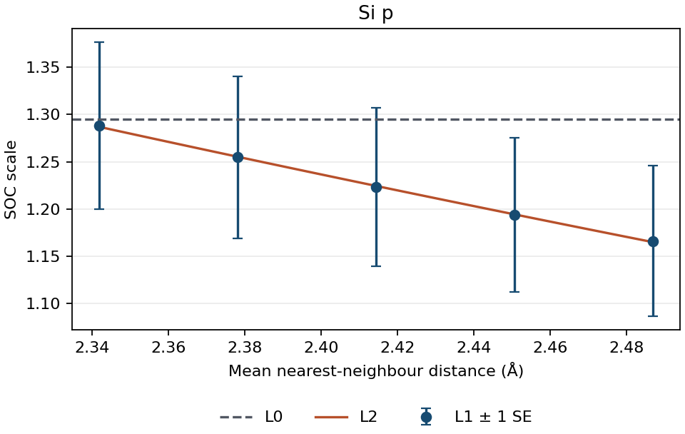

# Periodic SOC study

Scales multiply the shell-resolved Jha–Heine constants.

The reference source is GPAW 25.7.0 PW/PBE post-SCF SOC (provisional).

## Valence residuals

Values and signed residuals (xTB − reference) are in meV.

| Sample | Observable | Reference | σ | L-1 | L0 | L1 | L0 valence-only |
| --- | --- | --- | --- | --- | --- | --- | --- |
| Si_-0.03 | gamma_vb | 48.078 | 0.003 | -15.698 | -6.147 | -6.363 | -7.797 |
| Si_-0.03 | l_vb | 31.807 | 0.002 | -5.823 | 1.848 | 1.675 | 0.522 |
| Si_-0.015 | gamma_vb | 47.010 | 0.002 | -14.289 | -4.637 | -5.952 | -6.305 |
| Si_-0.015 | l_vb | 30.944 | 0.002 | -4.901 | 2.788 | 1.741 | 1.460 |
| Si_+0 | gamma_vb | 46.007 | 0.003 | -12.964 | -3.218 | -5.584 | -4.902 |
| Si_+0 | l_vb | 30.144 | 0.002 | -4.045 | 3.662 | 1.790 | 2.330 |
| Si_+0.015 | gamma_vb | 45.064 | 0.002 | -11.718 | -1.883 | -5.255 | -3.582 |
| Si_+0.015 | l_vb | 29.401 | 0.001 | -3.249 | 4.474 | 1.826 | 3.139 |
| Si_+0.03 | gamma_vb | 44.177 | 0.003 | -10.545 | -0.625 | -4.958 | -2.339 |
| Si_+0.03 | l_vb | 28.711 | 0.001 | -2.508 | 5.231 | 1.850 | 3.893 |

## Conduction residuals

Values and signed residuals (xTB − reference) are in meV.

| Sample | Observable | Reference | σ | L-1 | L0 | L1 | L0 valence-only |
| --- | --- | --- | --- | --- | --- | --- | --- |
| Si_-0.03 | gamma_cb | 35.156 | 0.044 | -11.470 | -4.484 | -4.642 | -5.691 |
| Si_-0.03 | l_cb | 14.284 | 0.002 | — | — | — | — |
| Si_-0.015 | gamma_cb | 34.842 | 0.044 | -10.827 | -3.744 | -4.709 | -4.968 |
| Si_-0.015 | l_cb | 14.626 | 0.002 | — | — | — | — |
| Si_+0 | gamma_cb | 34.569 | 0.044 | — | — | — | — |
| Si_+0 | l_cb | 14.988 | 0.002 | — | — | — | — |
| Si_+0.015 | gamma_cb | 34.335 | 0.044 | — | — | — | — |
| Si_+0.015 | l_cb | 15.370 | 0.002 | -5.076 | -2.114 | -3.126 | -2.624 |
| Si_+0.03 | gamma_cb | 34.136 | 0.044 | — | — | — | — |
| Si_+0.03 | l_cb | 15.768 | 0.002 | -5.052 | -1.942 | -3.297 | -2.478 |

## Applicability flags

| Sample | Observable | Status | Detail |
| --- | --- | --- | --- |
| Si_-0.03 | l_cb | manifold_mismatch | xTB pattern 2; reference pattern 1,2 |
| Si_-0.015 | l_cb | manifold_mismatch | xTB pattern 2; reference pattern 1,2 |
| Si_+0 | gamma_cb | manifold_mismatch | xTB pattern 3; reference pattern 1,3 |
| Si_+0 | l_cb | unisolated_manifold | Reference splitting / adjacent scalar gap: xTB 0.730, reference 0.007 |
| Si_+0.015 | gamma_cb | manifold_mismatch | xTB pattern 3; reference pattern 1,3 |
| Si_+0.03 | gamma_cb | manifold_mismatch | xTB pattern 3; reference pattern 1,3 |

## Band-gap diagnostic

ΔE_g is the signed SOC-induced change in the band gap on the DFTB+ SCC mesh, in meV.

| Sample | L-1 | L0 | L1 | L0 valence-only |
| --- | --- | --- | --- | --- |
| Si_-0.03 | -10.844 | -14.039 | -13.966 | -13.487 |
| Si_-0.015 | -10.957 | -14.184 | -13.745 | -13.627 |
| Si_+0 | -11.062 | -14.321 | -13.530 | -13.758 |
| Si_+0.015 | -11.162 | -14.450 | -13.323 | -13.882 |
| Si_+0.03 | -11.250 | -14.562 | -13.116 | -13.990 |

## Fit scales and identifiability

The fit assumes a relative model error of 10%. Reduced χ² uses the data residuals and subtracts one degree of freedom per fitted scale.

The effect column is the largest estimated splitting change across the full scale range. Identifiability requires a change greater than 3σ for at least one eligible observable. Standard errors include the Gaussian prior in the Jacobian.

L1 fits use the observables eligible across all samples of the same material.

| Fit | Sample | Shell | Scale | SE | Identifiable | At bound | Max effect (meV) | Reduced χ² |
| --- | --- | --- | --- | --- | --- | --- | --- | --- |
| L0 | all | Si p | 1.2948 | 0.0347 | True | False | 33.648 | 1.365 |
| L1 | Si_-0.03 | Si p | 1.2881 | 0.0882 | True | False | 32.396 | 2.029 |
| L1 | Si_-0.015 | Si p | 1.2546 | 0.0859 | True | False | 32.737 | 1.919 |
| L1 | Si_+0 | Si p | 1.2232 | 0.0836 | True | False | 33.058 | 1.826 |
| L1 | Si_+0.015 | Si p | 1.1937 | 0.0816 | True | False | 33.361 | 1.745 |
| L1 | Si_+0.03 | Si p | 1.1660 | 0.0796 | True | False | 33.648 | 1.675 |
| L0 valence-only | all | Si p | 1.2439 | 0.0392 | True | False | 33.648 | 1.145 |

## Leave-one-sample-out evaluation

Held-out mean absolute splitting errors in meV. L0 common fits a constant scale using the same observables as L1. The L2 folds holding out the shortest and longest distances extrapolate.

| Held-out sample | Bands | L-1 | L0 | L0 common | L2 |
| --- | --- | --- | --- | --- | --- |
| Si_-0.03 | valence | 10.760 | 4.056 | 4.216 | 4.029 |
| Si_-0.03 | conduction | 11.470 | 4.923 | 6.113 | 4.718 |
| Si_-0.015 | valence | 9.595 | 3.746 | 3.916 | 3.844 |
| Si_-0.015 | conduction | 10.827 | 3.986 | 5.210 | 4.689 |
| Si_+0 | valence | 8.505 | 3.413 | 3.622 | 3.682 |
| Si_+0.015 | valence | 7.484 | 3.170 | 3.335 | 3.537 |
| Si_+0.015 | conduction | 5.076 | 2.091 | 2.553 | 3.117 |
| Si_+0.03 | valence | 6.527 | 2.886 | 3.055 | 3.414 |
| Si_+0.03 | conduction | 5.052 | 1.822 | 2.305 | 3.326 |
| All | valence | 8.574 | 3.454 | 3.629 | 3.701 |
| All | conduction | 8.106 | 3.205 | 4.045 | 3.962 |
| All | All | 8.440 | 3.383 | 3.748 | 3.776 |

## Splitting trends

Linear slopes in meV/Å against mean nearest-neighbour distance, for observables eligible at every sample of the material. Slopes for fitted models use held-out predictions.

| Material | Shell | Observable | Reference | L-1 | L0 | L0 common | L2 |
| --- | --- | --- | --- | --- | --- | --- | --- |
| Si | Si p | gamma_vb | -26.915 | 8.636 | 17.746 | 18.543 | -17.159 |
| Si | Si p | l_vb | -21.362 | 1.506 | 7.184 | 8.067 | -20.091 |

